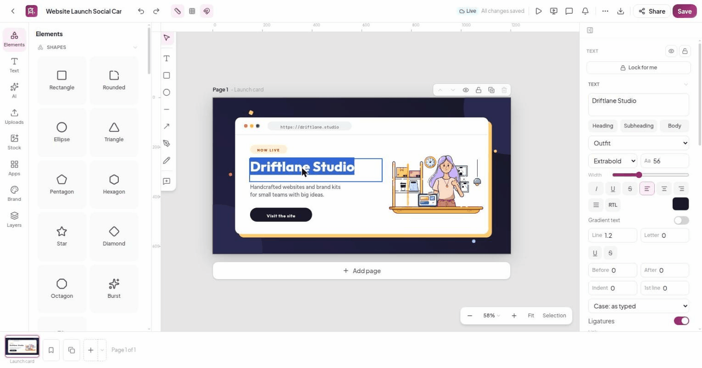
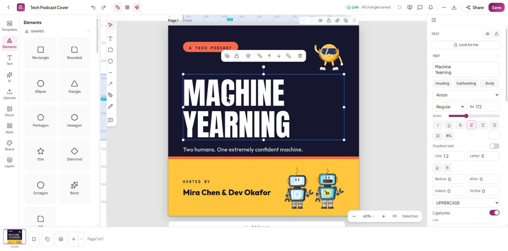
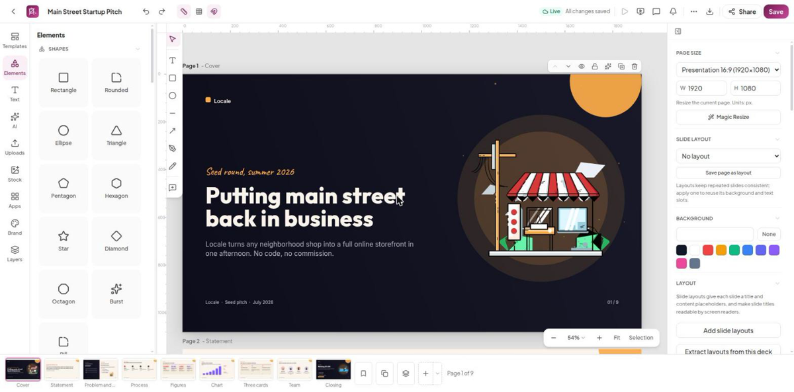
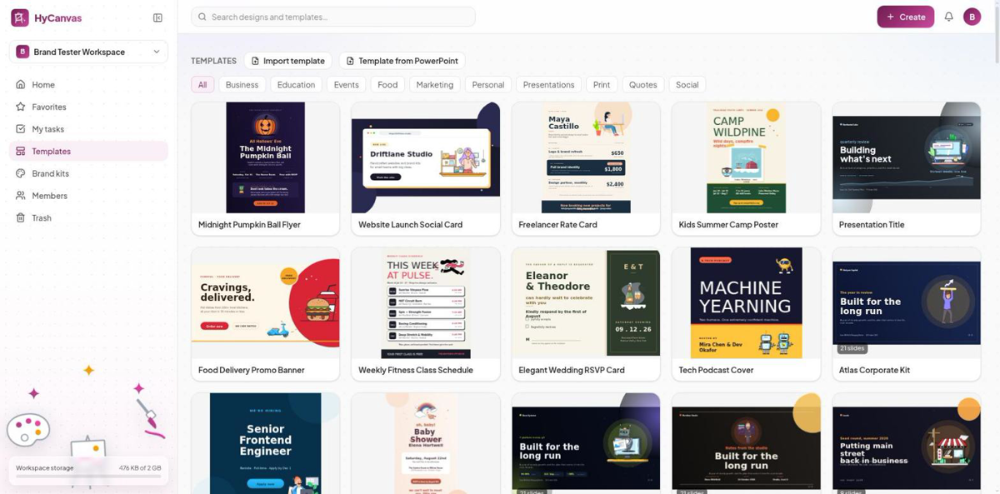
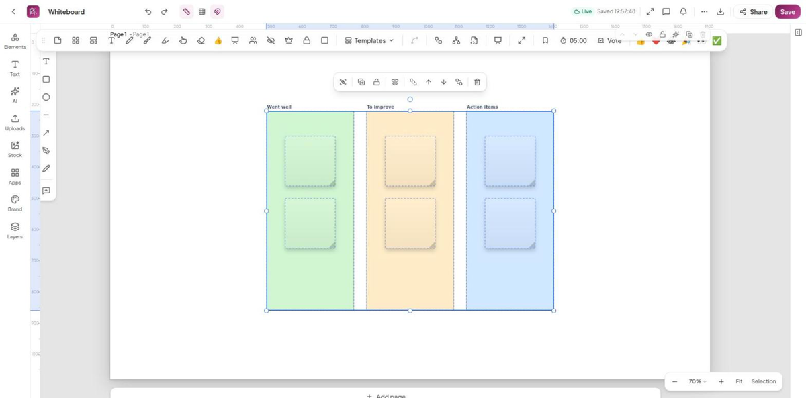

<p align="center">
  
</p>

<h1 align="center">HyCanvas</h1>

<p align="center"><b>The open-source Canva alternative you can self-host.</b></p>

<p align="center">
  <a href="LICENSE"></a>
  <a href="https://github.com/hyscaler/HyCanvas/releases/latest"></a>
  <a href="https://hub.docker.com/r/hycanvas/hycanvas"></a>
  <a href="https://docs.hycanvas.com"></a>
</p>

<p align="center">
  <a href="https://hycanvas.art"><b>Try it</b></a> ·
  <a href="https://docs.hycanvas.com"><b>Docs</b></a> ·
  <a href="#quickstart"><b>Self-host</b></a> ·
  <a href="https://youtu.be/Btai2nGP7VU"><b>Watch the one-minute film</b></a>
</p>

HyCanvas is a design editor that runs in the browser: social posts, posters, presentations, videos, whiteboards, docs and sheets, all in one app. Start from one of 140 templates or a blank page, edit everything on it, and export PNG, JPG, PDF, SVG, PPTX, MP4 or GIF with no watermark. Every feature is free, and you can run the whole thing on your own server with one Docker command.

It is pre-1.0 and moves fast, with a new release every week or two. Bug reports are very welcome.

<p align="center">
  
</p>

## What it can do

<table>
  <tr>
    <td width="50%" valign="top">
      
      <b>Editing.</b> Tools open from a rail on the left, the properties panel follows your selection, and a floating toolbar sits above whatever you pick.
    </td>
    <td width="50%" valign="top">
      
      <b>Presentations.</b> Slide layouts and themes, transitions including Magic Move, present mode with a presenter view, live audience polls and Q&amp;A, and PPTX in and out.
    </td>
  </tr>
  <tr>
    <td width="50%" valign="top">
      
      <b>Templates.</b> 140 built-in templates across social, print, events, business and presentations, plus your own saved templates and PowerPoint imports.
    </td>
    <td width="50%" valign="top">
      
      <b>Whiteboards.</b> Sticky notes, frames, connectors and ink, workshop templates, a shared timer and dot voting, and convert a board into a deck.
    </td>
  </tr>
</table>

| | |
| --- | --- |
| **Design** | Shapes, frames, tables, 9 chart types, QR codes, icons and illustrations, text effects, font pairings and your own fonts, image filters, crop and masks, background removal, Magic Resize |
| **Video** | Multi-track timeline with trims, transitions, keyframes, captions (SRT/VTT), green-screen keying, screen and webcam recording |
| **Docs and sheets** | A block editor with DOCX and PDF export, and spreadsheets with a formula engine |
| **Together** | Realtime co-editing with presence cursors, comments with mentions, version history, approvals, and share links that view, comment or edit |
| **Brand** | Brand kits with your colours, fonts, logos and voice, and a brand lock that warns or blocks off-brand edits |
| **AI, your key** | Bring your own provider key (13 presets including OpenAI, Anthropic, DeepSeek, Azure OpenAI and Amazon Bedrock, or any compatible endpoint), stored encrypted per workspace. Generate decks, docs, images and charts from a prompt. The Assist tools need no key. |
| **Export** | PNG, JPG, PDF, SVG, PPTX, APNG, GIF, Lottie, MP4 and WebM, with no watermark. Every design also downloads as a portable `.hyc` file in an open JSON format. |
| **Accounts** | Workspaces with roles, OIDC single sign-on, TOTP two-factor sign-in, dark mode |

The full checklist of what ships, and what is still on the roadmap, is on [docs.hycanvas.com](https://docs.hycanvas.com/guides/features/).

## Quickstart

You need Docker. This runs HyCanvas and its own Postgres on your machine:

```bash
mkdir hycanvas && cd hycanvas
curl -fsSLO https://raw.githubusercontent.com/hyscaler/HyCanvas/development/docker/docker-compose.yml
echo "JWT_SECRET=$(openssl rand -hex 32)" > .env
docker compose up -d
```

Open `http://localhost:8005` and create the first account. One Go binary serves the web app, the API and realtime collaboration on that port, and it applies its database migrations on boot. Update later with `docker compose pull && docker compose up -d`.

Other ways to run it:

- **Prebuilt binary** for Linux, macOS and Windows from the [releases page](https://github.com/hyscaler/HyCanvas/releases): unpack, run `./hycanvas service start`, and a setup wizard asks for your Postgres and storage. See [Install a prebuilt binary](docs/self-hosting.md#install-a-prebuilt-binary).
- **Production**: your own Postgres, a TLS reverse proxy, S3 storage, and single sign-on. See [Self-hosting](docs/self-hosting.md) and [DOCKER_SETUP.md](DOCKER_SETUP.md).

## Use it from an AI assistant (MCP)

Every instance serves a [Model Context Protocol](https://modelcontextprotocol.io) endpoint at `/mcp`, so an AI assistant can make decks, docs, posters and social sets in your workspace, grounded in your notes and your brand kit. Generation runs on the AI provider key connected to the workspace. A workspace admin creates a scoped API key (Dashboard > Members > API keys), then connects a client. For example, in Claude Code:

```bash
claude mcp add --transport http hycanvas https://your-instance.example.com/mcp \
  --header "Authorization: Bearer hyk_your_key"
```

Then ask for what you need:

- "Make a 6-slide deck on our Q3 results in the Midnight theme, and send me a share link."
- "Turn these meeting notes into a deck, then export it as a PDF."
- "List the templates I could start a webinar invite from."

The tools are `generate_presentation`, `get_job`, `list_templates`, `list_themes`, `get_design_file`, `export_design` and `create_share_link`, with the same scopes, rate budgets and audit trail as the REST API. The REST reference is served by every instance at `/api/docs` (OpenAPI at `/api/docs/openapi.json`), and `scripts/api-demo.sh` goes from prompt to PDF to share link with plain curl.

## FAQ

<details>
<summary><b>Is it free?</b></summary>
<br>

Yes. Every feature works on every plan, cloud or self-hosted, with no watermarks and nothing to unlock. Self-hosting costs nothing. Paid cloud plans price hosting capacity and support, not features.

</details>

<details>
<summary><b>Do I need an account?</b></summary>
<br>

Yes. On [hycanvas.art](https://hycanvas.art) you sign up for free; on your own instance you create the first account once it starts. Workspaces, sharing and collaboration are built on accounts.

</details>

<details>
<summary><b>Can I use it for my business?</b></summary>
<br>

Yes. Internal use and hosting an unmodified or AGPL-compliant instance need no extra license. To keep modifications private or embed HyCanvas in a proprietary product, see the [commercial license](COMMERCIAL.md).

</details>

<details>
<summary><b>Why AGPL plus a CLA?</b></summary>
<br>

The AGPL keeps HyCanvas and every hosted modification of it open. The [CLA](CLA.md) lets HyScaler also offer commercial licenses, which only works if every contributor grants that right. You keep ownership of your contribution, and code released under the AGPL stays available under the AGPL. The details are in [CONTRIBUTING.md](CONTRIBUTING.md#license-of-contributions-cla-required).

</details>

<details>
<summary><b>Where are my designs stored?</b></summary>
<br>

On hycanvas.art, with HyCanvas. When you self-host, in your own Postgres database and your chosen storage (local disk or any S3-compatible bucket).

</details>

<details>
<summary><b>How does the AI work without charging me?</b></summary>
<br>

You connect your own provider key and pay the provider directly; HyCanvas adds no markup. Keys are stored encrypted per workspace.

</details>

## Built with

TypeScript, React and Next.js in the browser, with a scene-graph rendering engine on Canvas2D; one Go binary on the server for the REST API, realtime collaboration and export; PostgreSQL, and local disk or any S3-compatible storage.

## Going further

- [docs.hycanvas.com](https://docs.hycanvas.com): user guides for the dashboard, the editor and every document type, plus operator guides.
- [Self-hosting](docs/self-hosting.md): Docker variants, the prebuilt binary, the production bundle, reverse proxies, uploads and S3, single sign-on, sign-in methods, CAPTCHA, and every environment variable.
- [DOCKER_SETUP.md](DOCKER_SETUP.md): the full Docker reference.
- [CONTRIBUTING.md](CONTRIBUTING.md): your first pull request, contributing templates, the repository layout, development setup, scripts, and releases.
- [`docs/roadmap/`](docs/roadmap/README.md): specs for work that is not built yet.

## Contributing

Contributions are welcome: code, translations, templates and docs. Start with [CONTRIBUTING.md](CONTRIBUTING.md) and the issues labelled [`good first issue`](https://github.com/hyscaler/HyCanvas/labels/good%20first%20issue). Please read the [code of conduct](CODE_OF_CONDUCT.md), and report vulnerabilities as described in [SECURITY.md](SECURITY.md).

## License

From v0.3.17 onwards, HyCanvas is open source under the [GNU Affero General Public License v3](LICENSE) (`AGPL-3.0-only`). You may use, modify, self-host, and redistribute it freely; if you distribute it, or let people use a modified version over a network, you must offer them the complete source of your version under the same license. Releases up to and including v0.3.16 were published under the Elastic License 2.0 and remain under those terms. Third-party and bundled-asset notices are in `NOTICE`.

- **Need to keep your modifications private, or embed HyCanvas in a proprietary product?** A [commercial license](COMMERCIAL.md) from HyScaler removes the AGPL obligations; internal use and AGPL-compliant hosting never need one.
- **Using the name or logo?** The HyCanvas and HyScaler marks are not covered by the AGPL; see the [trademark policy](TRADEMARKS.md). A modified version must use its own name.
- **Contributing?** All contributions require a one-time [Contributor License Agreement](CLA.md), signed with a single comment on your first pull request.

© 2026 HyScaler. HyCanvas is a HyScaler product. HyScaler® is a registered trademark.
